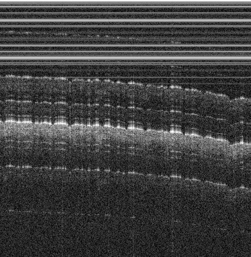

# DINOCT

DINO-style self-supervised pretraining for OCT B-scan images, plus curve head (LoRA) post-train stage.



## Repo layout

- `dinoct/`: Python package (models, data, training)
- `configs/`: YAML configs (merged: `configs/ssl_default_config.yaml` + `configs/train/oct.yaml`)
- `eval/`: evaluation entrypoints
- `tools/`: export and dataset-maintenance utilities

## Quick Start

- Python: `>=3.12`
- CUDA: single GPU

This repo uses `uv`:

```bash
uv sync
uv run python -m dinoct --help
```

Train the default OCT recipe end to end:

```bash
uv run python -m dinoct \
  --config configs/train/oct.yaml \
  --output-dir outputs/run1
```

This runs SSL pretrain followed by post-train using the values in `configs/train/oct.yaml`. It
needs nothing beyond the dataset, which is downloaded from Hugging Face on first run. Splits are
chosen randomly (seeded) and the run says so in its log. To reproduce the paper's exact
train/val/test protocol instead, see [Reproducing the paper](#reproducing-the-paper).

Outputs:

- `outputs/run1/pretrain/dinov3_pretrain.pth`
- `outputs/run1/pretrain/train.log`, `metrics.csv`, `config_used.yaml`
- `outputs/run1/post_train/fused_curve.pth`
- `outputs/run1/post_train/fused_curve_best.pth`
- `outputs/run1/post_train/val_summary.json`

To rerun only the curve post-train stage with an existing backbone, keep the same config and use:

```bash
uv run python -m dinoct \
  --config configs/train/oct.yaml \
  --output-dir outputs/run1 \
  --post-train-only \
  --pretrained-backbone outputs/run1/pretrain/dinov3_pretrain.pth
```

## Pretrained weights

Download the checkpoints from the GitHub release page and place them at the default
locations used by every entry point (release asset → destination):

- `pretrain.pth` → `outputs/pretrain/dinov3_pretrain.pth` — SSL backbone (ConvNeXt-tiny, patch 14, 625k steps)
- `post_train.pth` → `outputs/post_train/fused_curve_best.pth` — curve decoder

The release also carries `splits.csv` → `data/oct/extra/splits.csv` (the paper train/val/test
assignment), `curve_model.onnx` (a prebuilt copy of `exports/curve_model.onnx`, see Exporting), and
`paper_results_release_*.zip` (the paper's per-experiment result artifacts without checkpoints).

## Exporting 
### TorchScript/ONNX

```bash
uv run python tools/export_model.py --model outputs/post_train/fused_curve_best.pth --outdir exports
```

This writes `exports/curve_model.onnx` (opset 18) and `exports/curve_model.ts` with the
inference contract `image [batch,3,512,500] float32 -> presence_logits [batch], z_vec [batch,500]`.

Note: for ConvNeXt checkpoints the inference patch size cannot be inferred from the weights
(it changes geometry, not parameter shapes). The exporter assumes the paper training value
(patch 14); pass `--patch-size` explicitly if your training config differs, and validate the
export on real labeled frames rather than random inputs.

### Inference Notes

The exported graphs (.onnx model) contain **no resize or normalization** (the deployment platform does its own preprocessing in C++); feeding raw pixel values will not work.

## Dataset
Default expected layout under `data/oct/`:

- `data/oct/raw/*.jpg`
- `data/oct/background/*.jpg`
- `data/oct/labeled/<image_stem>.txt` (optional; marks an image as labeled)
- `data/oct/extra/entries.npy` (metadata cache; regenerated each run)
- `data/oct/extra/splits.csv` (paper train/val/test assignment)

Each label file should contain either:
- 500 floats (one per column), or
- a 500×2 table `(x, z)` (the second column is used).

The dataset is available at [https://huggingface.co/datasets/rjbaw/oct](https://huggingface.co/datasets/rjbaw/oct).
The held-out real-artifact stress set used by the stress evaluations ships there as a
separate archive. It already carries the `eval/stress/` prefix, so unpack it under `data/oct/`:
`tar -xzf eval.tar.gz -C data/oct` so that the final path would be `data/oct/eval/stress`.
The default config (`train.dataset_path: OCT:root=data/oct:hub=rjbaw/oct`) uses a local copy
under `data/oct/` when it holds the image tree (`raw/` or `background/`) and otherwise
downloads from the Hugging Face hub.

The hub archive contains the **images only** (`raw/`, `background/`, `labeled/*.txt`) plus
`extra/reference_background.jpg`. It carries no split metadata, and normal training does not need
any — see [Reproducing the paper](#reproducing-the-paper) if you want the paper's assignment.

### Labeling (curve editor)

The interactive curve label editor requires `matplotlib`:

```bash
uv sync --extra label
uv run python tools/data/curve_labeler.py --dir data/oct
```


## Reproducing the paper

Normal training needs none of this. These steps exist only to reproduce the published numbers.

**1. Split metadata** under `data/oct/extra/`. Use the released `splits.csv` and build the matching
manifest from your image tree:

```bash
uv run python tools/data/build_oct_manifest.py --dir data/oct
uv run python tools/data/build_oct_splits.py --dir data/oct
```

Splits are assigned per recording/session rather than per capture: timestamped C-scan captures
within 15 s of one another, exact duplicates, and near-duplicate average-hash matches share one
split unit. `recording_id` values are opaque stable IDs.

**2. The stress set** from the separate `eval.tar.gz` on Hugging Face. It already carries the
`eval/stress/` prefix, so unpack it under `data/oct/` and it lands in `data/oct/eval/stress/`:

```bash
mkdir -p data/oct && tar -xzf eval.tar.gz -C data/oct
```

These frames are excluded from the image archive, so the training pool never overlaps the stress
set — extract it whenever you need the stress evaluations.

**3. The SSL backbone** at `outputs/pretrain/dinov3_pretrain.pth` — download it from the release, or
generate it as below.

Use `eval/run_paper.py` as the entrypoint. Generate the paper SSL backbone if it is not already
present:

```bash
uv run python eval/run_paper.py pretrain
```

Run the OCT paper pipeline (training and evaluation into `outputs/paper_results/`):

```bash
uv run python eval/run_paper.py all
```

The defaults retain the paper's seeds (0–4) and post-train batch size (128).
Every experiment writes per-recording CSV/JSON summaries
under `outputs/paper_results/`; the paper reports the mean±std across recordings of the
seed-averaged per-recording metric. Use `--resume` to continue an interrupted run. Individual stages (`main`, `classical`,
`robustness`, `ablations`, `norms`, `lora-placement`, `low-data`) are available via
`eval/run_paper.py --help` if you only need one table.

- `classical` regenerates the classical OCT baselines into `outputs/paper_results/classical_eval/`.
- `robustness` regenerates the learned-model robustness suite and also refreshes the classical artifacts required by the paper robustness and failure-rate tables.
- `ablations` reruns the final single-component DINOCT ablations and can aggregate multiple seeds into `final_component_ablation.csv` plus per-seed rows in `final_component_ablation_per_seed.csv`.
- `low-data` regenerates the label-budget comparison and rewrites the data-efficiency manifests.
- `initialization` aggregates the released per-seed initialization scores into CSV/JSON summaries; it does not retrain models.

For the initialization comparison, extract the results release under `outputs/`, then run:

```bash
unzip /path/to/paper_results_release_20261027.zip -d outputs
uv run python eval/run_paper.py initialization --resume
```

This reads `outputs/paper_results/initialization/paired_seed_results.csv` and writes
`initialization_summary.csv` and `.json` beside it. `mae_px_seed_std` is population
std across downstream seeds 1–3 after equal-recording averaging. It uses the
paper's historical scoring view, not corrected-label scoring. Use `--input-csv`
and `--output-root` to override paths. To include this aggregation after `all`,
pass `--initialization-input outputs/paper_results/initialization/paired_seed_results.csv`.

## License
Apache-2.0, with one exception described below.

This project includes a substantial amount of code derived from Meta Platforms, Inc. and
affiliates' [DINOv2](https://github.com/facebookresearch/dinov2) repository, licensed under
the Apache License, Version 2.0 (see `LICENSE`).

The following files are derived from Meta Platforms, Inc. and affiliates'
[DINOv3](https://github.com/facebookresearch/dinov3) repository and are used and
redistributed under the terms of the DINOv3 License Agreement (see `LICENSE-DINOV3.md`),
as marked in their headers:

- `dinoct/data/augmentations.py`, `dinoct/data/collate.py`, `dinoct/data/datasets/decoders.py`
- `dinoct/layers/attention.py`, `dinoct/layers/block.py`, `dinoct/layers/ffn_layers.py`, `dinoct/layers/rope.py`
- `dinoct/loss/gram_loss.py`
- `dinoct/models/convnext.py`, `dinoct/models/vision_transformer.py`
- `dinoct/utils/__init__.py`, `dinoct/utils/utils.py`
